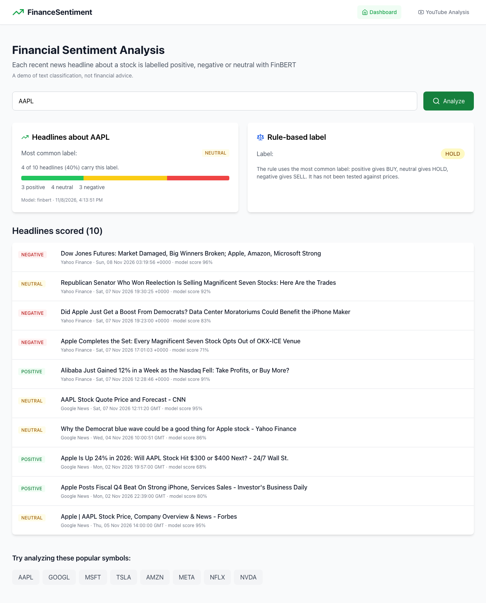

# Finance Sentiment

Type a stock symbol and the app collects recent news headlines about it and labels each one
positive, negative or neutral with [FinBERT](https://huggingface.co/ProsusAI/finbert). It shows
every headline with its label and how many headlines fall under each label. It can also score
the transcript of a YouTube video.

FastAPI backend, React frontend, one Docker image.



## How well the sentiment model works

Test set: the 2,388 labelled headlines in the validation split of
[twitter-financial-news-sentiment](https://huggingface.co/datasets/zeroshot/twitter-financial-news-sentiment),
financial news headlines posted on Twitter (MIT licence).¹ Each headline is scored on its own.

| Method | Accuracy | Macro F1 | Negative: precision / recall | Positive: precision / recall |
|---|---|---|---|---|
| Always answer "neutral" | 65.6% | 0.264 | – / 0% | – / 0% |
| Keyword list (`SENTIMENT_MODEL=keywords`) | 72.4% | 0.550 | 67.6% / 27.1% | 67.5% / 32.4% |
| **FinBERT, as the app uses it** | **72.5%** | **0.668** | **49.4% / 76.1%** | **61.1% / 59.8%** |
| TF-IDF + logistic regression, trained on this dataset's 9,543 training headlines | 83.2% | 0.761 | 75.5% / 60.5% | 77.4% / 67.0% |

- **Recall** is the share of truly negative (or positive) headlines that a method finds.
  **Precision** is how often a method is right when it gives that label.
- **Macro F1 is the fairer number.** Two out of three headlines are neutral, so accuracy flatters
  weak methods. Macro F1 weighs the three labels equally.
- **FinBERT finds negative news.** It finds 76% of negative headlines; the keyword list finds 27%.
  The two have the same accuracy: the 0.1-point gap is far inside the ±1.8-point margin of error
  for 2,388 headlines.
- **FinBERT overcalls "negative".** When it says "negative" it is right 49% of the time. Of its 271
  wrong "negative" labels, 213 are neutral headlines (`evaluation/results.json` has the full
  confusion matrix).
- **A model trained on this kind of text does better.** A simple word-based model trained on the
  dataset's own training headlines beats FinBERT on macro F1 (0.761 against 0.668). FinBERT was
  trained on a different set, Financial PhraseBank (Malo et al., 2014), according to its model card.
  Training FinBERT on these headlines is the next step.
- The keyword list was written before this test was run and was not tuned on it.

The table measures single headlines. The app also adds article summaries and combines many
headlines into one result; that part is not measured.

Reproduce: `pip install -r backend/requirements.txt -r evaluation/requirements.txt`, then
`python evaluation/evaluate.py`. It pins the dataset and model versions and writes
`evaluation/results.json`, library versions included.

¹ The dataset card's table lists 2,486 validation rows; the published files hold 2,388.

## How a stock gets its result

1. **Collect.** Five recent articles each from Yahoo Finance and Google News. Five more each from
   NewsAPI and Finnhub when their API keys are set.
2. **Add market feeds.** Posts from Investing.com, MarketWatch and Seeking Alpha are added when they
   name the symbol as a whole word (`AAPL` or `$AAPL`).
3. **Remove repeats.** The same headline from two places counts once.
4. **Label.** FinBERT labels each headline, with its summary when the summary adds something.
5. **Combine.** The overall label is the most common one, and the page shows what share of the
   headlines carry it. On a tie, neutral wins, then negative.
6. **Rule-based label.** Positive gives BUY, neutral gives HOLD, negative gives SELL.

When no source returns any article, the analysis endpoint answers "No recent news found" (HTTP 404).
It never fills in sample data.

## Limits

- **The BUY / HOLD / SELL label is not tested against prices.** It is the fixed rule above, not a
  trading signal and not financial advice.
- **Most stocks come out neutral,** because most headlines are neutral. The counts per label say
  more than the overall label.
- **English only.** FinBERT was trained on English text. For a video without English captions, the
  app asks YouTube for an English translation and gives up if there is none.
- **Long transcripts.** FinBERT reads about 350 words at a time, so a transcript is split into
  300-word pieces (up to 40) and their scores are averaged.
- **Feeds are not always on topic.** Yahoo Finance's feed for a symbol sometimes includes
  headlines about other companies, and they are scored too.
- **YouTube often blocks cloud servers,** so the video page may work only when you run the app
  yourself.

## Run it

**Docker** (one container serves both the API and the web page):

```bash
docker compose up --build
# open http://localhost:8000
```

The image downloads FinBERT (438 MB) while it builds and then runs offline, so the first request
does not wait for a download.

**Local development:**

```bash
# Backend (Python 3.12)
cd backend
python -m venv .venv && source .venv/bin/activate
pip install --extra-index-url https://download.pytorch.org/whl/cpu -r requirements-dev.txt
uvicorn app.main:app --reload --port 8000

# Frontend, in a second terminal (it forwards /api calls to port 8000)
cd frontend
npm ci && npm run dev
# open http://localhost:3000
```

Settings go in `backend/.env` (copy `backend/.env.example`):

| Variable | Meaning |
|---|---|
| `SENTIMENT_MODEL` | `finbert` (default) or `keywords`, for machines that cannot hold the model |
| `NEWS_API_KEY`, `FINNHUB_API_KEY` | Optional extra news sources |

## API

Interactive documentation is at `/docs` once the app is running.

| Method and path | What it returns |
|---|---|
| `GET /api/analysis/symbol/{symbol}` | Every headline with its label, the counts, the overall label and the rule-based label |
| `GET /api/data/news/{symbol}` | The collected news articles (an empty list when no source answers) |
| `GET /api/data/feeds/{symbol}` | Market feed posts that name the symbol |
| `POST /api/sentiment/analyze` | Sentiment of one text: `{"text": "..."}` |
| `POST /api/sentiment/batch` | Sentiment of a JSON list of texts |
| `POST /api/sentiment/youtube/transcript` | Sentiment of a video transcript: `{"video_id": "..."}` |

The score next to each label is the model's own score. It is not a calibrated probability.

## Tests

```bash
cd backend
pytest              # the fast tests; news sources are faked, no network needed
pytest -m slow      # only the FinBERT test (downloads the model)
pytest -m ""        # everything
```

A GitHub Actions workflow (`.github/workflows/ci.yml`) runs the fast tests, builds the frontend,
and builds the Docker image and checks that it answers.

## Project layout

```
backend/app/
  main.py                         FastAPI app; also serves the built frontend
  routes/                         HTTP endpoints
  services/data_collector.py      news feeds, market feeds and YouTube transcripts
  services/sentiment_analyzer.py  FinBERT and the keyword list
  services/analysis_engine.py     combines the headline labels into one result
backend/tests/                    pytest tests
evaluation/evaluate.py            the measurement above
frontend/src/                     React app (Vite, Tailwind)
Dockerfile                        builds the frontend, then the Python image
```

## Licence

The code is released under the MIT License. The FinBERT model is licensed CC BY-NC-SA 4.0
according to its model card, which does not allow commercial use.
